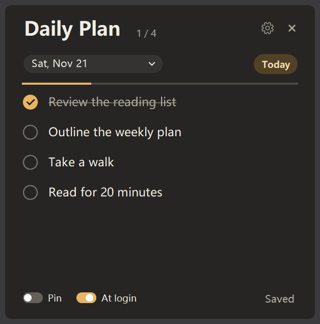
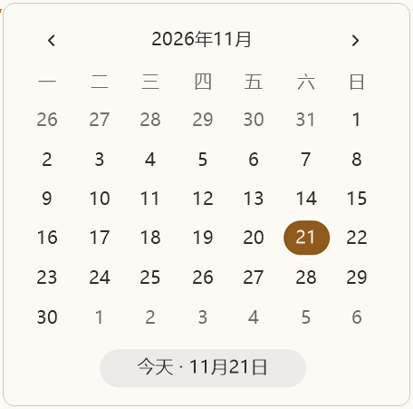
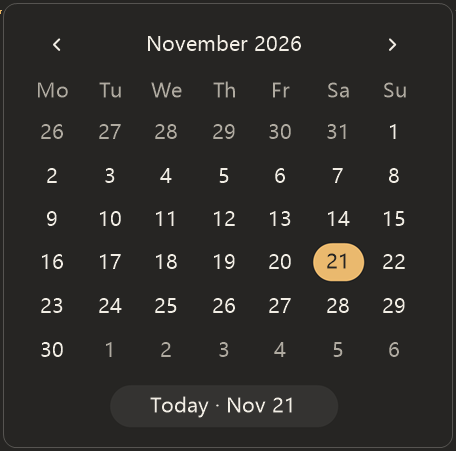

# Daily Plan Note · 每日计划

[简体中文](README.md) · **English** · [](LICENSE)

<a href="https://github.com/Neo3328/daily-plan-note/releases/latest/download/DailyPlanNote-Setup.exe"></a>
<a href="https://github.com/Neo3328/daily-plan-note/releases/latest/download/DailyPlanNote.exe"></a>
<a href="https://github.com/Neo3328/daily-plan-note/releases/latest/download/DailyPlanNote-macOS.dmg"></a>

**Run Setup to upgrade in place without uninstalling first. Your plans, checkmarks, and settings are preserved under the same Windows account.**

[Release notes and SHA-256 checksums](https://github.com/Neo3328/daily-plan-note/releases/latest)

Keep a daily checklist on your Windows or Mac desktop. Pick a date to see its plans, check off finished tasks, and switch between English and Simplified Chinese or light and dark themes.

| Platform | Installation |
| --- | --- |
| Windows installer | Download and run `DailyPlanNote-Setup.exe`, then follow the installation prompts. If prompted, allow Setup to close the running app and continue. |
| Windows portable | Save `DailyPlanNote.exe` in a permanent folder and double-click it. |
| macOS 13 or later | Open the DMG, drag Daily Plan Note into Applications, then open it from there. The universal app supports Apple silicon and Intel Macs. |

The native SwiftUI app for macOS includes a date picker, daily checklists, a keep-on-top switch, language and appearance settings, and an open-at-login option. It stores plans in your macOS user preferences. The current macOS build is ad hoc signed and has not been notarized by Apple.

## Screenshots

These screenshots show the Windows Forms app.

<table>
  <tr><th>Light theme</th><th>Dark theme</th></tr>
  <tr>
    <td align="center"></td>
    <td align="center"></td>
  </tr>
  <tr><th>Chinese calendar</th><th>English calendar</th></tr>
  <tr>
    <td align="center"></td>
    <td align="center"></td>
  </tr>
</table>

## Using the Windows app

If you use the portable edition, keep the executable in the folder you want to run it from. On first launch, the app enables startup at login. You can turn this off at the bottom of the note.

- Type a plan and press Enter to add another. Use the date picker to view a different day or select **Today** to return.
- Drag the header to move the note or drag its lower-right corner to resize it. The app remembers both the size and position.
- Open the gear menu to choose the system, light, or dark theme, switch languages, or toggle animations.
- Click **×** to hide the note in the system tray. Click the tray icon to restore it or right-click the icon to quit.

Windows stores plans, completion states, and preferences in `%LOCALAPPDATA%\DailyPlanNote`. Startup at login uses the `DailyPlanNote` entry in the current user's Run registry key.

## Build from source

On Windows, install or enable .NET Framework 4.8, then run this command from the repository root:

```bat
build.cmd
```

The script builds `bin\DailyPlanNote.exe` with the .NET Framework C# compiler. No NuGet packages are required. To create the Windows installer, build the executable first, then compile `installer/windows.iss` with Inno Setup 6.

On macOS, install Xcode and run `bash mac/build.sh` from the repository root. The script builds the universal disk image at `bin/mac/DailyPlanNote-macOS.dmg`.

## License and credits

The original code and icon are available under the [MIT License](LICENSE). Some easing functions and interaction timings were inspired by Plain Craft Launcher 2 by 龙腾猫跃. The source retains those acknowledgments.
