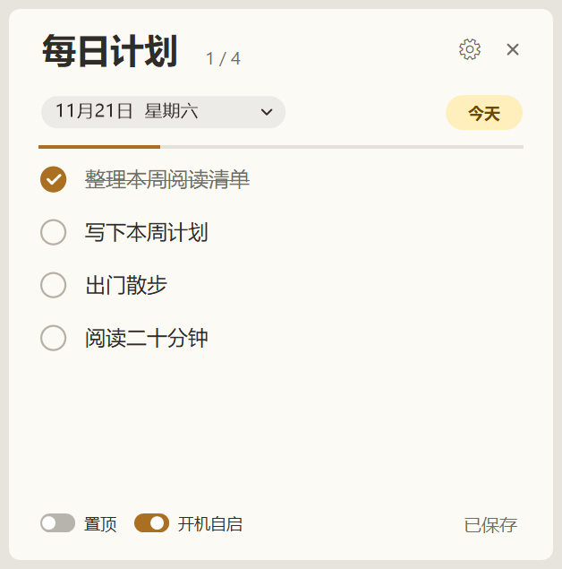
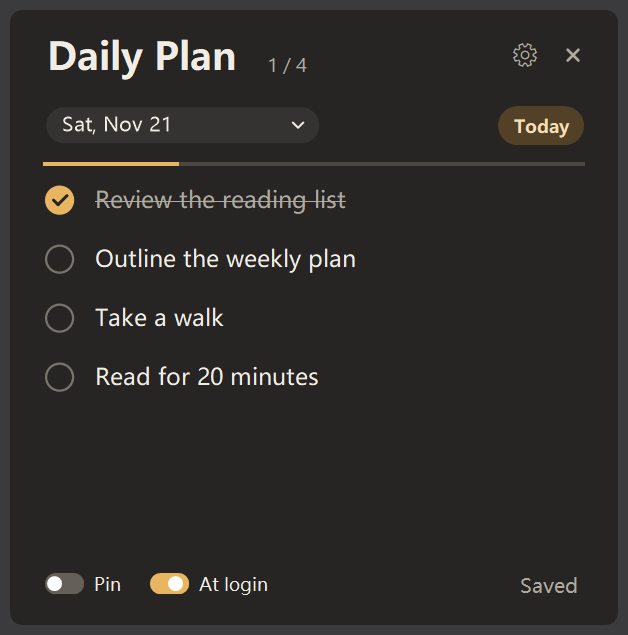
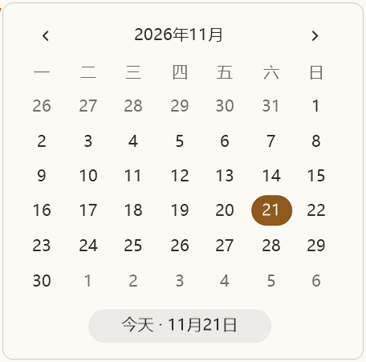
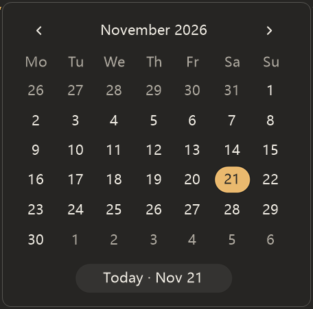

# 每日计划 · Daily Plan Note

<a href="https://github.com/Neo3328/daily-plan-note/releases/latest/download/DailyPlanNote.exe"></a>

[查看发布说明](https://github.com/Neo3328/daily-plan-note/releases/latest)

一个 Windows 桌面便签。按天记录计划，完成一项就打勾，文字会显示删除线。界面支持简体中文和 English。

## 界面预览

<table>
  <tr><th>浅色便签</th><th>深色便签</th></tr>
  <tr>
    <td align="center"></td>
    <td align="center"></td>
  </tr>
  <tr><th>中文日历</th><th>English calendar</th></tr>
  <tr>
    <td align="center"></td>
    <td align="center"></td>
  </tr>
</table>

## 使用

将下载的 `DailyPlanNote.exe` 放到准备长期使用的文件夹，双击运行。首次启动默认启用登录自启，可在便签底部关闭。

- 直接输入计划，按 Enter 新建一条。日期栏可切换到其他日期，「今天」可返回当天。
- 拖动标题区移动便签，拖右下角调整大小。应用会记住窗口布局。
- 点击齿轮可选择跟随系统、浅色或深色主题，也可切换语言和动效。
- 点击右上角的 × 收起到系统托盘。点击托盘图标恢复，右键菜单可退出。

计划、完成状态和偏好保存在当前账户的 `%LOCALAPPDATA%\DailyPlanNote`。登录自启使用当前用户注册表中的 `DailyPlanNote` 启动项。

## 从源码构建

在 Windows 上安装或启用 .NET Framework 4.8。在仓库根目录运行：

```bat
build.cmd
```

生成的程序位于 `bin\DailyPlanNote.exe`。源码使用 C# 和 Windows Forms。构建脚本调用系统的 .NET Framework C# 编译器，无需安装 NuGet 包。

## 许可与致谢

本项目原创代码与图标采用 [MIT 许可证](LICENSE)。部分动效的缓动公式与交互时序参考了龙腾猫跃的 Plain Craft Launcher 2，相关说明保留在源码中。
